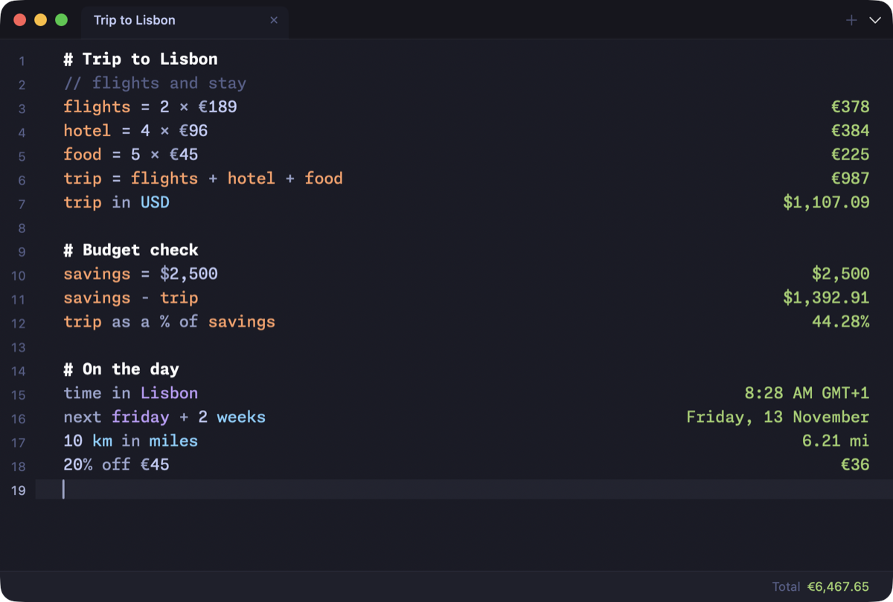

<div align="center">

# Tally

**A native macOS notepad calculator.** Type maths in plain language, and answers appear in a column on the right.




</div>

Tally is in the spirit of [Numi](https://numi.app). Each calculation is a plain `.txt` file in one folder (default `~/Documents/Tally`), so you can edit, sync or version them with any tool.

**Highlights**

- A hand-written lexer, parser and evaluator (`TallyEngine`) with no UI dependency, covered by XCTest
- Natural-language input: units, currencies, crypto, dates, time zones, percentages and number bases
- Live exchange rates from free, keyless APIs, cached locally
- A themed editor with tabs or a sidebar, line numbers, a current-line highlight, selectable monospaced fonts and Indian (lakh/crore) digit grouping

## Build

```bash
./build.sh            # builds build/Tally.app
./build.sh --install  # copies it to /Applications
swift test            # engine tests
```

## What it understands

- Arithmetic in symbols or words: `+ - * / ^ mod`, `plus`, `times`, `divided by`, `5!`, implicit `2 pi`, scales `5k`, `3 million`, `2 lakh`
- Percentages: `20% of 10`, `5% on 30`, `6% off 40`, `50 as a % of 100`, `5% of what is 6`, `$10 + 20%`
- Units: length, area, volume, mass, time, temperature, angles, data (SI and IEC), speed, frequency, CSS `px`/`pt`/`em` (set `em` / `ppi` variables); `5 feet 3 inches in cm`, `km/h in mph`, `sq m`, `m3`
- Currencies and crypto with live rates: `$10 in EUR`, `4 GBP in Euro`, `1 BTC in USD`
- Dates and time zones: `today + 3 weeks`, `next friday`, `2026-12-25 - today`, `time in Tokyo`, `2:30 pm HKT in Berlin`, `fromunix(…)`, `3 days ago`
- Number bases and bitwise: `255 in hex`, `0b1010`, `in sci`, `& | xor << >>`
- Functions: `sqrt cbrt root abs round ceil floor log ln exp fact sin cos tan asin acos atan sinh cosh tanh`
- Documents: `# headers`, `// comments`, `Label: expr` (also defines `Label` as a variable unless it is a built-in word like `Total`), variables (multi-word allowed), `prev`, `sum`/`total`, `avg`, document total

## Layout

- `Sources/TallyEngine` — lexer, parser/evaluator, units, currencies, formatting (no UI)
- `Sources/TallyApp` — SwiftUI/AppKit app: themed editor with results column, file library, settings
- `Tests/TallyEngineTests`

Exchange rates come from free, keyless public endpoints (open.er-api.com, Coinbase) and are cached in `~/Library/Application Support/Tally/rates.json`.

## License

[MIT](LICENSE) © Kenneth Gomes
